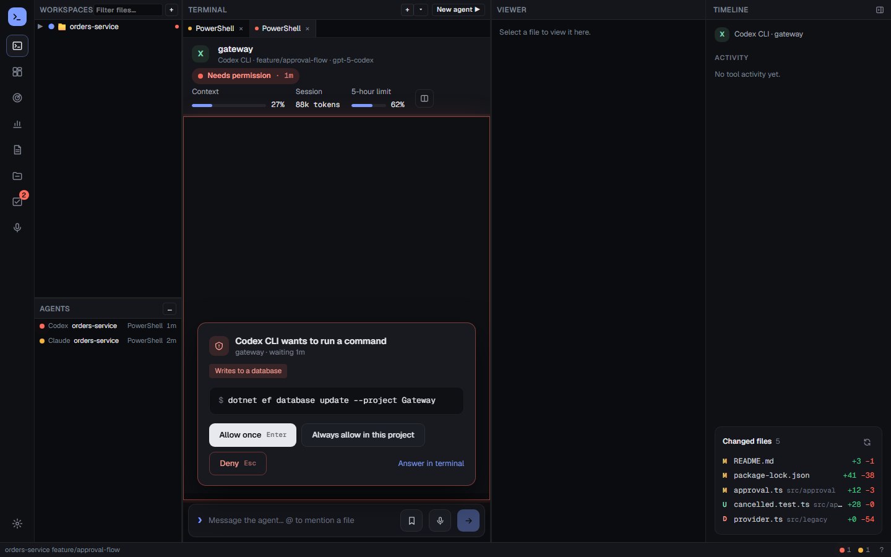
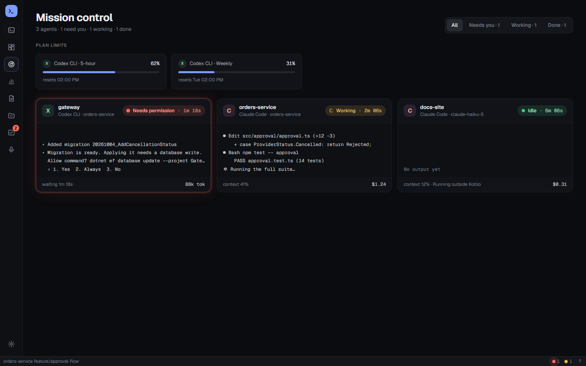
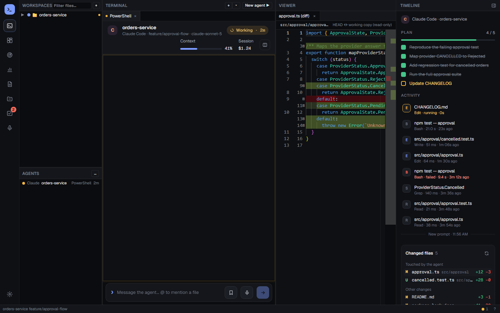
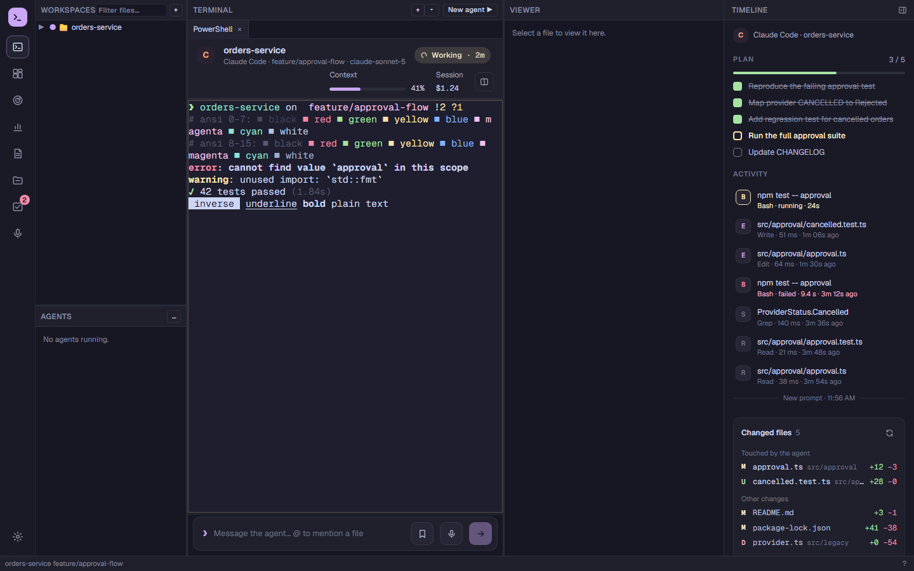
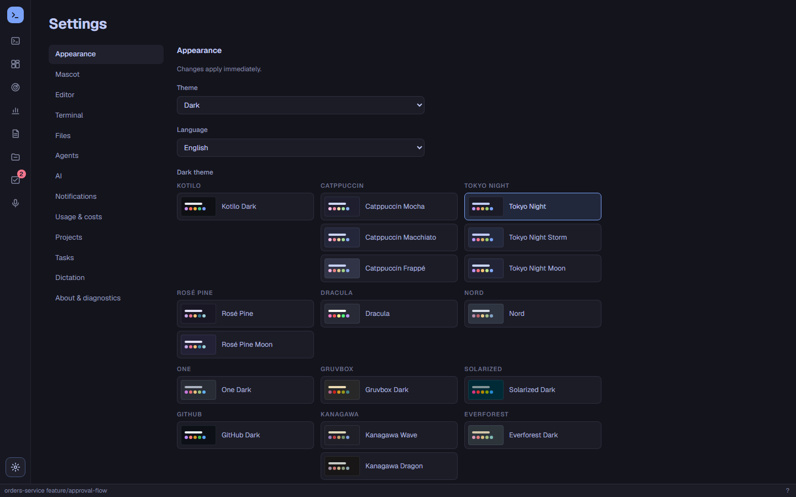
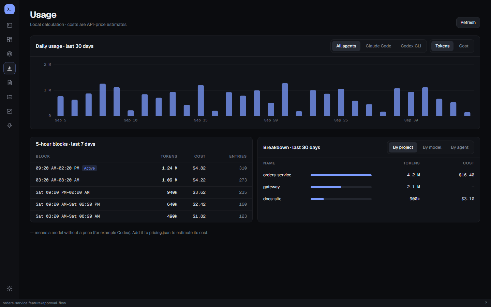

# Kotilo

A home for your AI coding agents: real terminals with live agent status, permission handling, usage, costs and limits in one desktop app.

**Website:** [kotilo.dev](https://kotilo.dev) · **Download:** [latest release](https://github.com/kotilo-dev/kotilo/releases/latest)

Kotilo is Finnish for a snail shell ("koti" means home). It is a portable shell you carry your agents around in. It is free and open source under the Apache License 2.0.

## What it is

Kotilo is a desktop workspace for Windows and Linux for people who run several AI coding agents side by side. Each agent runs in a real terminal, unmodified, signed in with your own account. Kotilo listens to the hooks or plugins the agents already provide and shows, for every session, whether it is working, waiting for your permission, waiting for input, done or failed. When an agent asks for permission, you can answer from a card or a notification without hunting for the right window.

Kotilo does not replace or wrap the agents. It does not include them, does not talk to their services on your behalf and never touches their login or token files.



<table>
  <tr>
    <td width="50%"></td>
    <td width="50%"></td>
  </tr>
  <tr>
    <td align="center"><b>Mission control</b>: every session at a glance</td>
    <td align="center"><b>Timeline and diff</b>: what the agent did and changed</td>
  </tr>
  <tr>
    <td width="50%"></td>
    <td width="50%"></td>
  </tr>
  <tr>
    <td align="center"><b>Themes</b>: the whole app and its terminals, here Catppuccin Mocha</td>
    <td align="center"><b>28 themes</b>: pick one for dark and one for light mode</td>
  </tr>
  <tr>
    <td colspan="2"></td>
  </tr>
  <tr>
    <td colspan="2" align="center"><b>Usage and cost</b>: tokens and estimated cost by day, block, project, model and agent</td>
  </tr>
</table>

<sub>Screenshots use invented demo data from the end-to-end tests.</sub>

## Features

- **Terminals:** tabs and split panes with real shells, agent CLIs and your own commands; clickable `file:line` links, file tree and viewer, diffs.
- **Live agent status:** working / waiting for permission / waiting for input / done / error, per session, including sessions started outside Kotilo.
- **Permission handling:** a card with the tool, the command or file and a risk label; allow once, always allow or deny with one click, or answer in the terminal.
- **Mission control and timeline:** every running agent on one screen, with a timeline of what each session did.
- **Finished work you have not looked at** stays marked as done, with a count on the Kotilo taskbar icon, and one "while you were away" summary when you come back to the computer.
- **Themes:** Kotilo, Catppuccin, Tokyo Night, Rosé Pine, Dracula, Nord, One, Gruvbox, Solarized, GitHub, Kanagawa and Everforest for the whole app; terminals follow the theme or use their own colour scheme, including schemes imported from Windows Terminal. Images (sixel) and Nerd Font icons in terminals.
- **Mascot:** an optional robot snail on the taskbar that shows the combined state of your agents and takes you to the one that needs you.
- **Composer:** write longer prompts with file mentions and saved prompts, then send them to an agent's terminal.
- **Usage, cost and limits:** tokens and estimated cost by day, project, model and agent; 5-hour blocks; plan limits where the agent reports them; CSV/Excel export.
- **Tasks and reports:** a personal task list, daily summaries, wait-time and cost reports.
- **Dictation:** push-to-talk speech-to-text with Whisper, running locally on your machine.
- **AI providers:** the app's own AI features (assistant, summaries, dictation cleanup) use either your installed agent CLI, headless, or any OpenAI-compatible endpoint (for example Ollama or LM Studio). API keys are stored in Windows Credential Manager (not yet on Linux).
- **Custom agents:** add any other agent CLI with an `adapter.json` file, and let it report its state through the Agent Integration Protocol.
- **Auto-updates** from GitHub Releases (can be turned off).
- English and Turkish user interface.

## Supported agents

| Agent | Status source | Usage data | Notes |
|---|---|---|---|
| Claude Code | Hooks (`~/.claude/settings.json`) | Yes, from its transcripts | Plan limits not shown yet (needs a status line helper, planned) |
| Codex CLI | Hooks (`~/.codex/hooks.json`) | Yes, from its session files | Plan limits from its session files; approve the hooks once in `/hooks` |
| GitHub Copilot CLI | Hooks (`~/.copilot/hooks/`, its own file) | Partial: tokens only after a clean `/exit`, no cost | No plan limits |
| Gemini CLI | Hooks (`~/.gemini/settings.json`) | Yes, from its chat recordings | Hooks run only in trusted folders |
| Qwen Code | Hooks (`~/.qwen/settings.json`) | Yes, from its chat recordings | |
| Factory Droid | Hooks (`~/.factory/hooks.json`) | Yes, from its session files | No permission card keys yet; answer in the terminal |
| OpenCode | Plugin (`~/.config/opencode/plugins/`) | Yes, from its database | Restart OpenCode after installing the plugin |
| Cursor CLI | Hooks (`~/.cursor/hooks.json`) plus screen rules for permission prompts | No data | |
| Plain shells | Terminal activity | No | PowerShell, cmd, Git Bash, WSL, … |
| Your own agent | Agent Integration Protocol and/or screen rules | Optional (protocol `usage` events) | See [docs/agent-protocol.md](docs/agent-protocol.md) |

Gemini CLI, Qwen Code, Factory Droid and Cursor CLI support was built from their documentation and has not yet been checked against a live install. Agents change their hooks and file formats; if something stops working, please open an issue.

Kotilo installs an agent's hooks or plugin only when you click **Install** for that agent. Every install makes a backup of the agent's config file first, keeps everything else in it, and **Uninstall** removes only Kotilo's own entries.

## Install

### Windows

1. Download the latest installer for your machine (`x64` or `arm64`) from [GitHub Releases](https://github.com/kotilo-dev/kotilo/releases).
2. Run it. The installer is per-user (NSIS): it installs into your user profile and needs no administrator rights.
3. Start Kotilo, open **Settings → Agents → Agent integrations** and install the integration for the agents you use.

Requirements: Windows 11 (x64 or ARM64) and the Microsoft Edge WebView2 Runtime, which most Windows 11 machines already have (the installer downloads it from Microsoft if it is missing).

**SmartScreen and Smart App Control:** until releases are signed (see [Code signing policy](#code-signing-policy)), Windows SmartScreen may warn about an unknown publisher; choose **More info → Run anyway** if you trust the download. Smart App Control blocks unsigned apps entirely; with it turned on you need a signed release or a build from source.

### Linux (x64)

Download one package from [GitHub Releases](https://github.com/kotilo-dev/kotilo/releases):

- **Debian, Ubuntu:** `sudo apt install ./Kotilo_<version>_amd64.deb`
- **Fedora, openSUSE:** `sudo dnf install ./Kotilo-<version>-1.x86_64.rpm`
- **Any distribution:** `chmod +x Kotilo_<version>_amd64.AppImage`, then run it

Then start Kotilo and install the agent integrations as above. Requirements: a desktop with WebKitGTK 4.1 (Ubuntu 22.04, Debian 12, Fedora 38 or later); the .deb and .rpm pull it in. Terminals use your login shell (`$SHELL`), then zsh, bash, fish or pwsh.

Not on Linux yet: dictation, the mascot, global hotkeys, the taskbar badge, the back-at-the-desk summary and saving API keys for OpenAI-compatible AI providers (no keyring support yet; the installed agent CLI works). The tray icon needs a desktop with AppIndicator support (on GNOME, the AppIndicator extension).

macOS support is planned.

## Privacy

- **No telemetry.** No analytics, crash reports or tracking of any kind.
- **No transcript content at rest.** Agent prompts and responses are never written to Kotilo's database or logs; only counts and metadata (times, states, token counts, file paths). Dictated audio is never stored; the recognized text is kept in a local dictation history that you can clear or turn off.
- **Never touches agent credentials.** Kotilo does not read, copy, store or send any agent's login or token files.
- **Agent config files stay yours.** Hooks are installed only when you ask, backup-first, and only Kotilo's own entries are ever added or removed.
- **Your data stays local.** Settings, session metadata, usage, tasks and reports live in local folders. AI provider keys live in Windows Credential Manager.

The only network connections are listed under [Code signing policy](#code-signing-policy) and in the [privacy policy](docs/legal/privacy.md).

## Build from source

Prerequisites: Windows 11, [.NET 10 SDK](https://dotnet.microsoft.com/download), [Rust](https://rustup.rs/) stable with the MSVC toolchain, [Node.js](https://nodejs.org/) LTS, Git.

```sh
npm --prefix apps/desktop ci

# UI first: tauri::generate_context! needs apps/desktop/dist to exist before the first cargo build
npm --prefix apps/desktop run build
npm --prefix apps/desktop test

cargo build --workspace
cargo test --workspace
cargo clippy --workspace --all-targets -- -D warnings

dotnet build hub/AgentHub.sln
dotnet test hub/AgentHub.sln

# Optional: Microsoft's ConPTY next to the dev exe, for images (sixel) in terminals
./scripts/fetch-conpty.ps1 -Arch x64 -Into target/debug/conpty

# Run the app in development mode
npm --prefix apps/desktop run tauri dev

# End-to-end UI tests (Playwright, mocked IPC + fake hub)
npm --prefix apps/desktop run e2e
```

A release installer is built with `./scripts/release.ps1 -Arch x64` (or `arm64`); see the script header for details.

## Project layout

```
apps/desktop/      Tauri 2 app: src/ (React + TypeScript), src-tauri/ (Rust core + platform layer), docs/ (in-app help)
crates/hook/       hook sidecar the agents call (agenthub-hook)
crates/proto/      wire types shared by the app and the hook sidecar
hub/               .NET 10 background service: Hub.Core, Hub.Infrastructure, Hub.Service, Hub.Contracts, tests/
adapters/<id>/     built-in agent definitions (adapter.json, fixtures, OpenCode plugin)
schema/            JSON Schemas: adapter definition, hook envelope, Agent Integration Protocol
scripts/           release, signing and notice generation scripts
docs/              protocol and API docs, decisions, legal
```

Design and architecture: [PRD.md](PRD.md), [ARCHITECTURE.md](ARCHITECTURE.md), [DESIGN_SYSTEM.md](DESIGN_SYSTEM.md), [docs/DECISIONS.md](docs/DECISIONS.md).

## Contributing

Bug reports, fixes and new agent adapters are welcome. Read [CONTRIBUTING.md](CONTRIBUTING.md) first; it covers setup, the project's hard rules and how to add an agent. Questions go to [GitHub Discussions](https://github.com/kotilo-dev/kotilo/discussions), bugs and feature requests to [GitHub Issues](https://github.com/kotilo-dev/kotilo/issues). Security issues: see [SECURITY.md](SECURITY.md).

## Code signing policy

Free code signing provided by [SignPath.io](https://about.signpath.io/), certificate by [SignPath Foundation](https://signpath.org/).

Kotilo is applying to the SignPath Foundation. Until the project is accepted, release binaries are unsigned (`v0.1.0` is an unsigned beta); this section will say from which version on releases are signed.

- **What is signed:** Kotilo's own binaries, built from this repository: the installer and uninstaller, `kotilo.exe`, `kotilo-hub.exe` and `kotilo-hook.exe`. Third-party libraries shipped with the app (for example `e_sqlite3.dll` and the Whisper runtime) and Microsoft's ConPTY (`conpty.dll`, `OpenConsole.exe`, already signed by Microsoft) are not signed by this project.
- **Builds:** release binaries are built by GitHub Actions from this repository ([`.github/workflows/release.yml`](.github/workflows/release.yml), [`scripts/release.ps1`](scripts/release.ps1)); nothing is built or signed on a personal machine for a release.
- **Committers and reviewers:** [@xmsadik](https://github.com/xmsadik). Changes from other contributors are reviewed by a committer before they are merged.
- **Approvers:** [@xmsadik](https://github.com/xmsadik) approves each signing request manually.
- **Team security:** everyone with write access to the repository or access to the signing project uses multi-factor authentication.

**Privacy:** this program will not transfer any information to other networked systems unless specifically requested by the user or the person installing or operating it. The exceptions, all of which you control:

- **Update check:** asks GitHub Releases (github.com and GitHub's download hosts) whether a new version exists. On by default at startup; can be turned off in **Settings → About & diagnostics**.
- **Whisper model download:** fetches the speech model from Hugging Face, only when you choose a model for dictation.
- **AI providers you configure:** the app's AI features send their request to the provider you chose, either your installed agent CLI or an OpenAI-compatible endpoint you entered, only when such a feature runs.

Details: [docs/legal/privacy.md](docs/legal/privacy.md).

## License

Copyright 2026 The Kotilo Authors. Licensed under the [Apache License, Version 2.0](LICENSE); see also [NOTICE](NOTICE). Third-party components and their licenses are listed in [THIRD_PARTY_NOTICES](THIRD_PARTY_NOTICES).

## Trademarks

Kotilo works with Claude Code, Codex, GitHub Copilot CLI, Gemini CLI, Qwen Code, Factory Droid, OpenCode and Cursor CLI. It is an independent open-source project, not affiliated with, sponsored by or endorsed by Anthropic, OpenAI, GitHub/Microsoft, Google, Alibaba, Factory, SST/OpenCode or Anysphere. Their product names are trademarks of their respective owners and are used only to describe compatibility. See [docs/legal/trademarks.md](docs/legal/trademarks.md).
